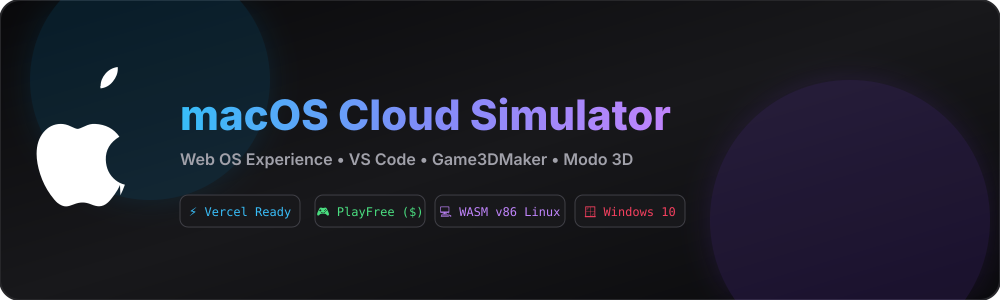

# 🍏 macOS Cloud Simulator — Web OS Enterprise v4.0

[](https://opensource.org/licenses/MIT)
[](https://vercel.app)



Simulador web avanzado de **macOS** con gestión de servidores en la nube en **servers.com**, control de versiones con **CloudHub (Git)**, soporte multilenguaje global y simulación de vida en 3D.

---

## 🌟 Novedades v4.0 Enterprise

* 🌐 **servers.com (Hosting Simulator):** Alquila servidores web, hosts de Minecraft y bases de datos con generación de ingresos pasivos.
* ☁️ **CloudHub (Git Platform):** Plataforma de repositorios colaborativos con gestión propia de commits y control de versiones.
* 🌍 **Selector Multilingüe Global:** Cambia el idioma del sistema a español, inglés, francés, alemán, japonés, chino, ruso y árabe al instante.
* 🏠 **Mundo 3D & Sistema de Mamá:** Explora tu casa en primera persona, evita que te descubran usando la laptop de trabajo de tu mamá y escapa de asaltos callejeros.

---

## 📂 Estructura del Proyecto

```text
macos-cloud-sim/
├── index.html        # Núcleo y emulador completo
├── banner.svg        # Banner oficial
├── vercel.json       # Configuración para Vercel
├── favicon.svg       # Icono SVG de macOS
├── README.md         # Documentación oficial
└── LICENSE           # Licencia MIT

```

---

## 📄 Licencia

Bajo Licencia **MIT**.
